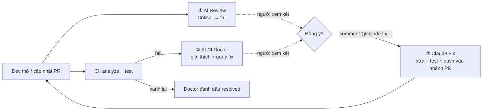

# AI in CI/CD — Flutter demo

Demo cho seminar **"Ứng dụng AI vào CI/CD"** — giai đoạn 1: **CI**.
App Flutter nhỏ (shop + mã giảm giá), mỗi PR được kiểm tra bởi pipeline thường + AI.
AI là **Claude Code** chạy trong GitHub Actions (`anthropics/claude-code-action`), xác thực bằng token gói Claude Pro/Max.



| Workflow | Trigger | Làm gì |
|---|---|---|
| `ci.yml` | PR, push main | `flutter analyze` + `flutter test` (không AI) |
| `ai-review.yml` | PR | Claude review diff theo `.github/ai-review-rules.md` → JSON → comment sticky, **fail nếu có Critical** |
| `claude-fix.yml` | comment `@claude` trên PR | Claude sửa trên nhánh PR, chạy analyze + test, push commit → CI + AI Review chạy lại |
| `ai-ci-doctor.yml` | CI fail | Claude đọc log fail + diff + code → nguyên nhân gốc + cách sửa; CI xanh lại → đánh dấu resolved |

```
.github/
├── workflows/            khi nào chạy, chạy gì (YAML)
├── scripts/
│   ├── ai.py             helper: gọi GitHub API, comment PR, ghi Summary
│   ├── review.py         ① render JSON review của Claude + gate Critical
│   └── ci_doctor.py      ② gom log/diff cho Claude + render chẩn đoán
└── ai-review-rules.md    luật team → prompt của reviewer
```

## Setup Claude (1 lần)

Trên máy, trong thư mục repo chạy `claude` rồi gõ `/install-github-app` → chọn repo → nó cài Claude GitHub App và tạo secret `CLAUDE_CODE_OAUTH_TOKEN`.
(Cách tay: `claude setup-token` → copy token → repo **Settings → Secrets and variables → Actions → New secret** `CLAUDE_CODE_OAUTH_TOKEN`.)

## Cách AI review hoạt động

1. Workflow gọi Claude Code với **prompt** (trong `ai-review.yml`) + quyền **chỉ đọc** (`Read, Grep, Glob, git diff/log/show`).
2. Claude đọc `.github/ai-review-rules.md` (luật team, quyết định mức Critical/Major/…), chạy `git diff`, mở file liên quan nếu cần.
3. Claude trả về **JSON theo schema** (`--json-schema`): summary + danh sách findings.
4. `review.py` biến JSON thành comment trên PR; có `critical` → exit 1 → check đỏ.

Muốn đổi cách review → sửa `ai-review-rules.md` (luật) hoặc `prompt` (cách làm). Không phải tool đóng của GitHub.

## Luồng fix — có điều kiện, con người quyết định

1. AI Review / CI Doctor chỉ **đề xuất**.
2. Dev/lead đọc, đồng ý điểm nào thì comment trên PR, ví dụ `@claude fix lỗi Critical về secret, giữ nguyên VIP50`.
3. Điều kiện chạy: comment trên PR + có `@claude` + người comment có quyền **write** (action tự kiểm tra).
4. Claude sửa **trên nhánh PR** (không bao giờ push `main`, không sửa `.github/`), phải `flutter analyze` + `flutter test` pass mới commit.
5. Commit mới → CI + AI Review chạy lại → người review xem diff → tự bấm Merge.

## Thử luồng CI

```bash
./demo/run.sh 1   # PR có secret + logic tiền sai → AI Review báo Critical, check fail
./demo/run.sh 2   # PR làm test fail → CI đỏ → AI CI Doctor comment nguyên nhân
./demo/run.sh reset
```

Chi tiết: [docs/DEMO.md](docs/DEMO.md).

## Mang sang GitLab

| GitHub | GitLab |
|---|---|
| `pull_request` | `rules: - if: $CI_PIPELINE_SOURCE == "merge_request_event"` |
| `workflow_run` (CI Doctor) | job `when: on_failure` trong cùng pipeline, đọc log qua `/jobs/:id/trace` |
| Comment PR | Notes API `POST /projects/:id/merge_requests/:iid/notes` |
| `claude-code-action` | chạy `claude -p "..." --output-format json --json-schema ...` trong job (cài Claude Code CLI) |

## Giới hạn

- Dùng quota gói Claude; PR rất lớn tốn nhiều turn → giới hạn `--max-turns`.
- Claude chỉ được quyền đọc; CI Doctor không bao giờ chạy code của PR (tránh "pwn request").
- AI có thể sai → review chỉ chặn ở mức Critical, người review vẫn quyết định. AI lỗi → bỏ qua (fail-open).
- Code khách hàng: kiểm tra hợp đồng/chính sách dữ liệu trước khi cho AI đọc code.

## Giai đoạn sau

CD (build Android/iOS khi bấm tay hoặc nhánh `release/*`, AI viết QA checklist) và release (store notes).
