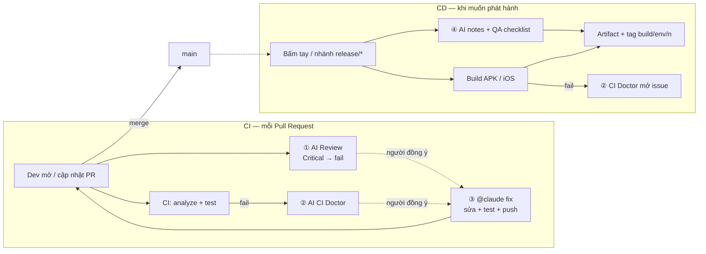

# AI in CI/CD — Flutter demo

Demo cho seminar **"Ứng dụng AI vào CI/CD"** trên một app Flutter nhỏ (shop + mã giảm giá).
AI là **Claude Code** chạy trong GitHub Actions ([`anthropics/claude-code-action`](https://github.com/anthropics/claude-code-action)).



| Workflow | Khi nào chạy | Làm gì |
|---|---|---|
| `ci.yml` | PR, push `main` | `flutter analyze` + `flutter test` (không AI) |
| `ai-review.yml` | PR | Claude review diff theo `.github/ai-review-rules.md` → comment sticky, **fail nếu có Critical** |
| `ai-ci-doctor.yml` | `CI` hoặc `CD` fail | Claude đọc log + diff + code → nguyên nhân gốc + cách sửa. Từ PR → comment PR; build CD (không có PR) → mở **issue**, build xanh lại → tự đóng |
| `claude-fix.yml` | comment `@claude …` trên PR | Claude sửa trên nhánh PR, chạy analyze + test, push commit → CI + AI Review chạy lại |
| `cd.yml` | bấm tay (chọn staging/production) hoặc push `release/**` | Build APK (+AAB production, +iOS tuỳ chọn), Claude viết "có gì mới" + QA checklist, gắn tag mốc |

```
.github/
├── workflows/             khi nào chạy, chạy gì
├── scripts/
│   ├── ai.py              helper: GitHub API, comment PR, job summary
│   ├── review.py          ① render review JSON + gate Critical
│   ├── ci_doctor.py       ② gom log/diff cho Claude + render chẩn đoán
│   └── cd_notes.py        ④ gom commit từ build trước + render build notes
└── ai-review-rules.md     luật review của team (prompt)
demo/run.sh                kịch bản demo
docs/DEMO.md               kịch bản seminar
```

## Dùng lại cho repo của bạn

1. Fork / copy repo.
2. Tạo token: cài [Claude Code](https://docs.claude.com/en/docs/claude-code), chạy `claude setup-token` (cần gói Claude Pro/Max).
3. Repo **Settings → Secrets and variables → Actions** → secret `CLAUDE_CODE_OAUTH_TOKEN`.
4. Cài [Claude GitHub App](https://github.com/apps/claude) cho repo.
5. **Settings → Rules → Rulesets → New branch ruleset** cho `main`:
   - *Require a pull request before merging* (team ≥ 2 người: *Required approvals = 1*)
   - *Require status checks to pass*: `Analyze & Test`, `AI Review`
   - *Block force pushes*

## AI review hoạt động thế nào

1. Workflow gọi Claude với **prompt** (`ai-review.yml`) + quyền **chỉ đọc** (`Read, Grep, Glob, git diff/log/show`).
2. Claude đọc `.github/ai-review-rules.md` → `git diff` → mở file liên quan nếu cần.
3. Trả về **JSON theo schema** (`--json-schema`) → `review.py` render comment, có `critical` → check đỏ.

Đổi cách review = sửa `ai-review-rules.md` (luật) hoặc `prompt` (cách làm). Có thể thêm `CLAUDE.md` cho convention dự án.

## Luồng fix — con người quyết định

- AI Review / CI Doctor chỉ **đề xuất**. Đồng ý thì comment, ví dụ `@claude chỉ xoá secret và print, giữ nguyên VIP50`.
- Chỉ người có quyền **write** gọi được. Claude sửa **trên nhánh PR**, không đụng `main` / `.github/`, phải pass analyze + test mới commit.
- Commit của Claude **cũng được AI Review lại** (`allowed_bots`) → người review xem diff → tự merge.

## CD — khi nào build?

Không build mỗi lần merge. Build khi **có ý định phát hành**:

- **Bấm tay:** Actions → **CD** → *Run workflow* → chọn `staging` / `production` (+ iOS nếu cần).
- **Nhánh release:** push `release/1.2.0` → tự build `staging`.

Mỗi build gắn tag `build/<env>/<n>`; lần sau Claude chỉ đọc commit **kể từ tag đó** để viết notes cho tester.
App hiển thị môi trường trên AppBar (`--dart-define=APP_ENV=staging`).

Demo ký Android bằng debug key, iOS `--no-codesign`. Lộ trình thật: keystore từ secrets, fastlane `match`/`gym`, gửi Firebase App Distribution / TestFlight.

## Bảo mật & giới hạn

- **PR từ fork** không nhận secret → AI Review **bỏ qua (fail-open)**, CI thường vẫn chạy; maintainer review tay.
- Claude review/doctor/notes chỉ có quyền **đọc**; CI Doctor không bao giờ **chạy** code của PR (tránh "pwn request" của `workflow_run`).
- `@claude fix` chỉ chạy cho người có quyền write.
- Không deterministic: cùng PR có thể ra kết quả hơi khác → chỉ chặn ở Critical, người review quyết định.
- Fail-open có mặt trái: gate "xanh" khi AI không chạy. Comment review ghi rõ commit được review và cảnh báo khi lần chạy lỗi.
- Tốn quota gói Claude → giới hạn `--max-turns`.
- Code khách hàng: kiểm tra hợp đồng / chính sách dữ liệu trước khi cho AI đọc.

## Mang sang GitLab

| GitHub | GitLab |
|---|---|
| `pull_request` | `rules: - if: $CI_PIPELINE_SOURCE == "merge_request_event"` |
| `workflow_run` (CI Doctor) | job `when: on_failure` cùng pipeline, đọc log qua `/jobs/:id/trace` |
| `workflow_dispatch` inputs | *Run pipeline* với variables / Jenkins "Build with Parameters" |
| Ruleset required checks | *Pipelines must succeed* + approval rules |
| Comment PR | Notes API `POST /projects/:id/merge_requests/:iid/notes` |
| `claude-code-action` | `claude -p "..." --output-format json --json-schema ...` trong job |
