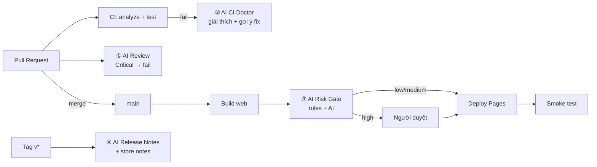

# AI in CI/CD — Flutter demo

Demo cho seminar **"Ứng dụng AI vào CI/CD"**: một app Flutter nhỏ (shop + giảm giá) và 4 pipeline có AI.
LLM dùng **GitHub Models** qua `GITHUB_TOKEN` → **không cần API key, miễn phí**.



| Workflow | Trigger | AI làm gì |
|---|---|---|
| `ci.yml` | PR, push main | (không AI) analyze + test |
| `ai-review.yml` | PR | Review diff theo `.github/ai-review-rules.md`, comment sticky, **fail nếu có Critical** |
| `ai-ci-doctor.yml` | CI fail | Đọc log fail + diff → nguyên nhân gốc + cách sửa; CI xanh lại → đánh dấu resolved |
| `cd.yml` | push main | Rules + AI chấm rủi ro deploy; **high → chờ người duyệt**; deploy GitHub Pages; smoke test |
| `release.yml` | tag `v*` | Viết release notes (dev) + store notes VI/EN, tạo GitHub Release |

Script AI nằm ở `.github/scripts/` (Python stdlib, không cài gì). `ai.py` gọi endpoint OpenAI-compatible nên đổi provider chỉ bằng biến môi trường.

## Setup (1 lần)

```bash
# 1. Tạo platform folders (android/ios/web) — cần Flutter trên máy
flutter create . --platforms=android,ios,web --project-name ai_cicd_demo
flutter test

# 2. Push
git init && git add -A && git commit -m "feat: AI in CI/CD demo"
git branch -M main
git remote add origin https://github.com/trungnt-2399/AI-in-CI-CD.git
git push -u origin main
```

Trên GitHub repo:

1. **Settings → Pages → Source: GitHub Actions**
2. **Settings → Environments → New `production-approval`** → tick *Required reviewers* → thêm chính bạn
3. (Tuỳ chọn) **Settings → Secrets and variables → Actions → Variables**: `AI_MODEL` (mặc định `openai/gpt-4o-mini`, có thể đổi `openai/gpt-4.1`, …)
4. Lần push đầu, CD sẽ ra risk **HIGH** (vì có `pubspec.yaml` + `.github/`) → vào tab Actions bấm **Review deployments → Approve**. App chạy ở `https://trungnt-2399.github.io/AI-in-CI-CD/`.

## Chạy demo

Xem [docs/DEMO.md](docs/DEMO.md). Tóm tắt:

```bash
./demo/run.sh 1   # PR có secret + logic tiền sai → AI Review Critical
./demo/run.sh 2   # PR làm test fail → AI CI Doctor
./demo/run.sh 3   # PR thêm dependency → merge → CD chờ duyệt
./demo/run.sh 4   # tag release → AI release notes
./demo/run.sh reset
```

## Mang sang GitLab / dự án thật

| GitHub (demo) | GitLab |
|---|---|
| `pull_request` | `rules: if: $CI_PIPELINE_SOURCE == "merge_request_event"` |
| `workflow_run` (CI Doctor) | job `when: on_failure` trong cùng pipeline, đọc log qua API `/jobs/:id/trace` |
| `environment` + required reviewers | `when: manual` hoặc protected environment approvals |
| GitHub Models | `AI_BASE_URL` trỏ tới Ollama/vLLM trên runner nội bộ, hoặc gateway công ty |
| Comment PR | Notes API: `POST /projects/:id/merge_requests/:iid/notes` |

## Giới hạn cần nói trong seminar

- Free tier GitHub Models: giới hạn request/phút và ~8k token input → script đã cắt diff (`truncate`). Dự án lớn nên dùng agent (Claude Code, …) đọc theo file.
- AI có thể sai → mọi gate đều có **rules cứng làm sàn** + **người duyệt** ở bước rủi ro cao. AI lỗi: review *fail-open*, risk gate *fail-safe (medium)*.
- Không gửi secret/log nhạy cảm cho provider bên ngoài; với code khách hàng dùng model self-host.
