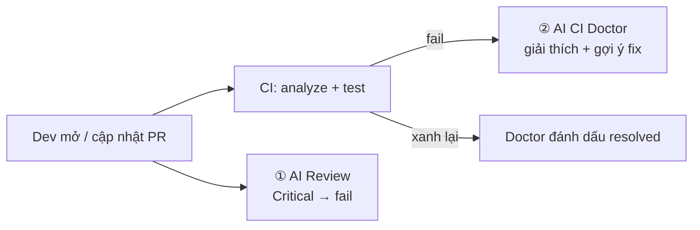

# AI in CI/CD — Flutter demo

Demo cho seminar **"Ứng dụng AI vào CI/CD"** — giai đoạn 1: **CI**.
App Flutter nhỏ (shop + mã giảm giá), mỗi PR được kiểm tra bởi pipeline thường + AI.
LLM dùng **GitHub Models** qua `GITHUB_TOKEN` → **không cần API key, miễn phí**.



| Workflow | Trigger | Làm gì |
|---|---|---|
| `ci.yml` | PR, push main | `flutter analyze` + `flutter test` (không AI) |
| `ai-review.yml` | PR | AI review diff theo `.github/ai-review-rules.md`, comment sticky, **fail nếu có Critical** |
| `ai-ci-doctor.yml` | CI fail | AI đọc log fail + diff → nguyên nhân gốc + cách sửa; CI xanh lại → đánh dấu resolved |

```
.github/
├── workflows/            khi nào chạy, chạy gì (YAML)
├── scripts/
│   ├── ai.py             gọi LLM (OpenAI-compatible), comment PR, ghi Summary
│   ├── review.py         ① AI Review
│   └── ci_doctor.py      ② AI CI Doctor
└── ai-review-rules.md    luật team → prompt của reviewer
```

## Thử luồng CI

```bash
./demo/run.sh 1   # PR có secret + logic tiền sai → AI Review báo Critical, check fail
./demo/run.sh 2   # PR làm test fail → CI đỏ → AI CI Doctor comment nguyên nhân
./demo/run.sh reset
```

Chi tiết: [docs/DEMO.md](docs/DEMO.md).

## Mang sang GitLab

| GitHub | GitLab |
|---|---|
| `pull_request` | `rules: - if: $CI_PIPELINE_SOURCE == "merge_request_event"` |
| `workflow_run` (CI Doctor) | job `when: on_failure` trong cùng pipeline, đọc log qua `/jobs/:id/trace` |
| Comment PR | Notes API `POST /projects/:id/merge_requests/:iid/notes` |
| GitHub Models | `AI_BASE_URL` → Ollama/vLLM nội bộ hoặc gateway công ty |

## Giới hạn

- Free tier GitHub Models: giới hạn request/phút, ~8k token input → script cắt bớt diff/log.
- AI có thể sai → review chỉ chặn ở mức Critical, người review vẫn quyết định. AI lỗi → bỏ qua (fail-open).
- Code khách hàng: dùng model self-host, không gửi ra ngoài.

## Giai đoạn sau

CD (build Android/iOS khi bấm tay hoặc nhánh `release/*`, AI viết QA checklist) và release (store notes).
